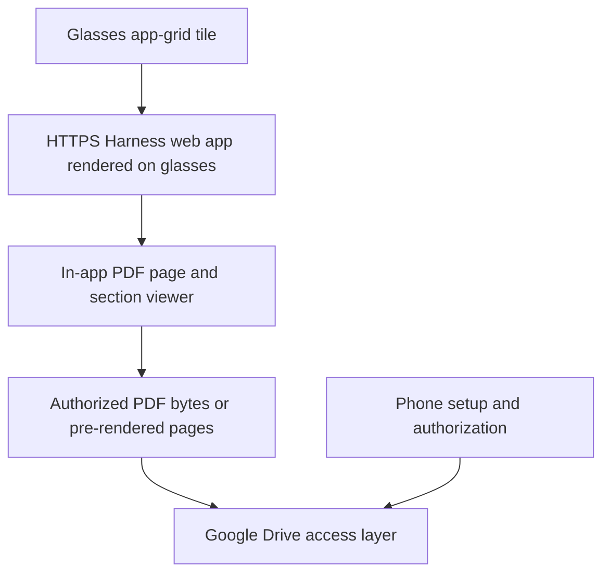
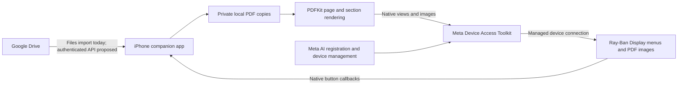

# Harness HUD: corrected architecture review

## Correction: a separate on-glasses Web Apps platform exists

The previous review examined only Meta's Device Access Toolkit (DAT), missed the separate Web Apps platform, and incorrectly treated a native phone companion as necessary. That conclusion is superseded.

Independent evidence:

- [RecipeGuide issue 1](https://github.com/brianscout/RecipeGuide/issues/1), closed as completed, specifies GitHub Pages → Meta AI registration → a tile in the glasses app grid → launching the page on the glasses. This is a developer report, not our own device verification.
- [Agent Guild device support report](https://github.com/oddessentials/agent-guild/issues/310) describes a 600×600 glasses web client installed by scanning a phone QR code and confirming on glasses. It reports needing Developer Mode. Its server-dependent app does not prove our PDF workflow works.
- [DisplayList developer report](https://github.com/facebook/meta-ray-ban-display-ui-toolkit-web/issues/1) reports a Next.js web app and a focus bug reproduced/fixed on real glasses; Meta contributors responded with toolkit improvements.

Official corroboration:

- [Meta Wearables Web App toolkit](https://github.com/facebook/meta-wearables-webapp), reviewed at `038a8b0e4db3a86b75200c196d5af312628f7c72`, explicitly describes HTML/CSS/JavaScript apps rendered on Ray-Ban Display.
- Its README documents publicly accessible HTTPS hosting, QR installation, and manual installation: Meta AI → Devices → Display Glasses settings → App connections → Web apps → Add a web app → name and URL. Settings labels and feature availability still need checking on the user's software version.
- [Meta's Display UI toolkit](https://github.com/facebook/meta-ray-ban-display-ui-toolkit-web), reviewed at `1bdf42979eea6606ebcdc77571416d17794c09a9`, provides React components, native-style directional focus, QR samples, a simulator, and an app-icon generator.
- The generator documents `.well-known/meta-wearables-manifest.json` in the launch URL directory, with custom app name and appearance/icon metadata. This is separate from the ordinary PWA `manifest.webmanifest` in our existing site.
- Meta's sample index uses `fb-viewapp://web_app_deep_link?appName=...&appUrl=...` for add-to-glasses QR links.

## Recommended architecture for the icon-launch requirement

An installed web-app entry offers the documented route to an icon/tile launch. A standalone sideloaded Android APK is a different capability and remains unestablished. The phone may still supply connectivity or setup services; web-app support does not prove phone-free operation.

A custom iOS app is optional unless a specific authorization, storage, or background requirement calls for one. Keep the native prototype as an alternative; do not require Xcode merely to try a glasses web app.

## Current web milestone

The app now includes Meta's input-routing tag, launcher identity metadata, white-on-transparent PNG icons, a phone installation page/QR, and an internal two-page viewer using prepared PDF images. The viewer has page boundaries, zoom, bounded movement, and no URL entry. Browser regression tests pass; Meta's official manifest validator accepts the metadata. Installation on the user's glasses and actual PDF readability remain unverified. Private Drive access and arbitrary-PDF loading are not implemented.

## What remains to build or verify

1. Test adding a known official sample, then our existing HTTPS URL, through Meta's documented Web Apps installation path. Verify an app-grid entry and real navigation. Our existing website has not been installed/tested on the glasses.
2. MRBD metadata/icon and explicit directional focus are implemented. Test actual glasses focus behavior; the full Display UI toolkit has not been adopted. Ordinary PWA metadata alone is not proof of proper glasses integration.
3. The paste-a-link form is replaced by a saved demo menu and in-app image viewer. Extend it to real documents after hardware validation; arbitrary PDF and Google Drive access remain unimplemented.
4. Investigate PDF.js or pre-rendered page tiles under the documented low CPU/bandwidth budgets. Large dense PDFs may require preprocessing. Keep technical labels and revision identifiers legible.
5. Choose a private Drive access design. A static GitHub Pages app cannot automatically read private Drive files; Google OAuth, CORS, token handling, refresh, and consent rules must be established. A phone-based authorization/setup flow and an authenticated backend may be appropriate. Public links must not be required for private engineering files. Do not promise live Drive folder browsing until this is implemented and tested.
6. Verify cookies/storage persistence, network availability, cache limits, suspend/resume, and whether the phone is needed for connectivity. A website being reachable from the phone does not validate these properties.

The existing 600×600 browser prototype remains a starting point. The native iOS project is source-only and still unbuilt/unverified. The following DAT-specific review is preserved as a historical record of that alternative; its statements about missing web-app/launcher evidence are superseded by this correction.

---

# Historical DAT-only architecture review

Reviewed against Meta's official public iOS SDK main commit `bbae597cd1c748cd29b9375a1624a8d75b1c9e14` and published release `1.0.1`. The remote main HEAD was rechecked during this review. This is a documentation and source review, not device validation.

## Supported implementation path

The business logic, document storage, authentication, PDF processing, and navigation state live on the phone. The SDK sends display components to the glasses and delivers interaction callbacks. This is a native display integration, not screen mirroring, an HTML browser session, or documented standalone APK deployment. The glasses contain system software, but the reviewed public SDK does not establish general-purpose APK installation privileges.

The phone needs to remain available to run the experience. A background mode declaration does not prove uninterrupted execution when the phone is locked, suspended, force-quit, or disconnected. Meta's runtime controls session lifecycle. Bluetooth LE, Bluetooth Classic, and Wi-Fi paths have different configuration requirements; do not describe every interaction as using a fixed transport.

## What the evidence establishes

| Capability | Evidence and limit | This repository |
| --- | --- | --- |
| Native custom content on Ray-Ban Display | Documented `MWDATDisplay`: text, FlexBox, buttons, images, icons, video | Implemented in source; unbuilt and untested on hardware |
| Choose saved documents on glasses | Button callbacks are documented; app can replace the sent view | Paginated library menu implemented |
| PDF pages on glasses | SDK accepts `UIImage`; PDFKit can rasterize locally. No native PDF component is documented | PDFKit image rendering implemented; real layout/readability pending |
| Native page controls | SDK Button and ButtonGroup callbacks documented | Previous/Next, Zoom/section cycle, Fit page, Documents implemented |
| Raw navigation/drag events | Separate Inputs capability; experimental and requires Developer Center enablement; no production publishing yet | Not used |
| Voice launch | Voice Invocations documents “Hey Meta, start {app name}”; bundle ID, spoken name, and approval configured in Developer Center; experimental, no production publishing yet | Not implemented |
| Select our app icon in the glasses launcher | No documented launcher-registration or custom tile installation procedure found in the reviewed SDK docs/sample | Unresolved; do not promise |
| An iPhone Home Screen icon | Standard signed iOS app deployment | Sample icon retained; branded icon not designed |
| Install our standalone Android APK on glasses | No supported sideloading/install procedure established by reviewed official SDK | No implementation; Android SDK is a companion-app option |
| Public website on glasses | No general-purpose browser launch path established by this review | Existing GitHub Pages site is a separate phone/browser prototype |
| Import private Drive PDFs without public links | iOS Files provider import does not require public sharing | Implemented file import; provider availability requires phone testing |
| Browse a live Drive folder from glasses | Proposed: Google OAuth on phone, Drive API listing/downloads, native glasses menu | Not implemented |
| Read imported files without cloud access | Files copied locally; cloud is unnecessary for the stored PDF bytes | Storage implemented. Offline SDK/session startup has not been tested; registration needs internet |
| Phone-free operation | Not supported by this companion architecture | Not implemented |

The `Icon` display component is an icon inside a rendered view, not evidence of a glasses launcher entry. The SDK's “Update app on glasses” flow is also not evidence that arbitrary APKs can be installed.

## Launch and connection lifecycle

The current path is: install and open the iPhone app → register through Meta AI → resolve a compatible display-capable device → start DeviceSession → attach/start Display → wait for readiness → send menu → react to callbacks and send updated content.

Registration establishes permission to integrate; it does not by itself establish launcher visibility. The SDK documentation says registration requires internet and development requires Meta glasses Developer Mode. We have not located that toggle on the user's device. It remains a prerequisite, not a completed step. iPhone Developer Mode for running a signed development build is separate.

A stopped session must be recreated. Opening the glasses again does not automatically restart it. Another experience, removal/folding of glasses, connection loss, or unregistering can interrupt the session. Reconnection and locked-phone behavior need acceptance tests.

Voice launch is a potential later path after approval and implementation, not a guaranteed way to cold-start an app under every iOS process state. We must test foreground, background, locked, and terminated cases and describe the supported cases only.

## Google Drive design

Phase 1 imports selected PDFs through the phone's Files picker. Google Drive must be installed, authenticated, and enabled as an iOS Files provider where offered. Files are downloaded/copied into app storage once. The glasses list those copies. File deletion in the app does not delete Drive originals. Reimport is required after a source update. PDF import does not list a live remote folder.

Phase 2 can add Google sign-in and Drive API access in the iPhone app:

1. Configure a Google Cloud project and an iOS OAuth client associated with the app bundle ID. Do not embed a confidential client secret in a native app.
2. Request the narrowest permission that supports the chosen workflow. A picker granting access to selected files differs from enumerating an arbitrary existing folder; read-only folder browsing may need broader scopes and Google's verification rules must be checked for the selected release model.
3. Select a folder/account on the phone; save file IDs and metadata, not expiring download URLs.
4. Fetch a bounded list of PDFs, download authorized bytes on the phone, and render locally. Never transmit Google bearer tokens to glasses or place them in image URLs.
5. Store authentication using the supported Google sign-in library/secure storage. Handle revocation, expiry, account changes, download failures, and organizational restrictions.
6. Cache approved PDFs and show revision/sync time; distinguish a cached copy from the latest available revision. Provide explicit refresh and account disconnect/delete behavior.

A custom backend is not inherently required for a personal native Drive client. Google Cloud/OAuth configuration and internet are still needed for cloud access. Commercial distribution, OAuth scope review, Meta release-channel approval, and Apple distribution are separate requirements. This review did not fetch current Google OAuth policy pages, so the precise consent/verification obligations are not yet verified.

## Document presentation

A 600×600 design target does not guarantee a full PDF is legible. The implementation renders a 600×400 page image and reserves the rest of the intended layout for labels/buttons; the actual native layout must be inspected on glasses. Two-times-fit corner views are a starting point, not arbitrary magnification or continuous pan.

A useful production viewer should add variable zoom/tiles, thumbnails or page jump, bookmarks, and a structured pinout/reference mode. Large text and extracted tables often work better than a whole datasheet page. Preserve diagram labels, pin numbers, page identifiers, and revision. Never silently truncate technical content or treat generated summaries as approved wiring instructions.

## Validation gates before promising the workflow

1. On the Mac, resolve SDK 1.0.1, compile the project, select signing, and install it on the iPhone. These checks cannot run in this Linux workspace.
2. Resolve Meta glasses Developer Mode/registration and any firmware/glasses-app update requirements. Display Meta's unchanged tutorial and test native buttons first.
3. Import the included fixture; test all PDF controls, rotation, multiple documents/menu pagination, restart persistence, invalid PDFs, and Drive provider import.
4. Test phone lock/background, display interruption, disconnect/reconnect, offline cached reading, and battery/thermal behavior.
5. Inspect both Meta AI's registered integrations and the glasses launcher after registration. Record whether our entry appears, whether it starts a session, and under which phone states. Do not infer it from a phone icon or an in-view display icon.
6. If launcher access is essential and absent, obtain a documented Meta integration/approval path before advertising that experience. Evaluate approved voice launch as an alternative without promising unsupported OS behavior.

## Sources

Official Meta repository documents below were read directly. The Wearables Developer Center host was blocked by the cloud network policy; portal-only behavior and account-specific approvals could not be checked. Missing launcher documentation is an evidence limit, not proof that no partner/private mechanism exists.

- [Official SDK overview and distribution model](https://github.com/facebook/meta-wearables-dat-ios/blob/bbae597cd1c748cd29b9375a1624a8d75b1c9e14/README.md)
- [DisplayAccess sample, prerequisites and startup](https://github.com/facebook/meta-wearables-dat-ios/blob/bbae597cd1c748cd29b9375a1624a8d75b1c9e14/samples/DisplayAccess/README.md)
- [Display rendering, buttons, images and link configuration](https://github.com/facebook/meta-wearables-dat-ios/blob/bbae597cd1c748cd29b9375a1624a8d75b1c9e14/plugins/mwdat-ios/skills/display-access/SKILL.md)
- [Registration and developer versus release channels](https://github.com/facebook/meta-wearables-dat-ios/blob/bbae597cd1c748cd29b9375a1624a8d75b1c9e14/plugins/mwdat-ios/skills/permissions-registration/SKILL.md)
- [Voice launch, approval and experimental restriction](https://github.com/facebook/meta-wearables-dat-ios/blob/bbae597cd1c748cd29b9375a1624a8d75b1c9e14/plugins/mwdat-ios/skills/voice-invocations/SKILL.md)
- [Experimental raw Inputs capability](https://github.com/facebook/meta-wearables-dat-ios/blob/bbae597cd1c748cd29b9375a1624a8d75b1c9e14/plugins/mwdat-ios/skills/inputs/SKILL.md)
- [Session lifecycle and interruptions](https://github.com/facebook/meta-wearables-dat-ios/blob/bbae597cd1c748cd29b9375a1624a8d75b1c9e14/plugins/mwdat-ios/skills/session-lifecycle/SKILL.md)
- [Published changelog and experimental publishing limits](https://github.com/facebook/meta-wearables-dat-ios/blob/bbae597cd1c748cd29b9375a1624a8d75b1c9e14/CHANGELOG.md)
- [Official Android companion SDK](https://github.com/facebook/meta-wearables-dat-android)
